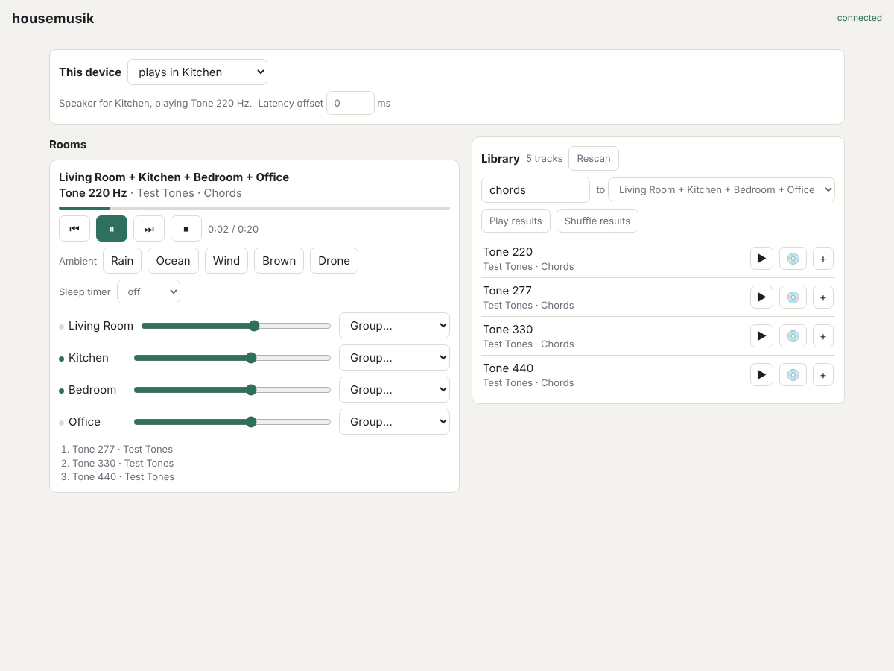

# housemusik

housemusik plays music and background sound throughout a house, using
browsers you already have as the speakers and the remotes.

A small server on your home network reads your music folder. Any phone,
tablet or computer that opens its web page can act as a remote: see every
room, start an album or a playlist, add ambient sound, change volume, or set a
sleep timer. A device left in a room, such as an old tablet, a laptop plugged
into an amplifier, or a Raspberry Pi, can be set to play for that room.



## What it does

- **Plays your own library.** It takes its playlist from a table in a local
  MariaDB database, or, without one, from a music folder organized as
  Artist / Album / Track. Changes to the table show up within a few seconds.
  There is no streaming service or account involved.
- **Ambient sound.** Rain, ocean, wind, brown noise and a soft drone are
  generated by each speaker as they play, so they don't need recordings and
  they don't loop.
- **Rooms and groups.** Each room can play something different, or rooms can
  be grouped so several play the same thing. Grouped rooms stay in step with
  each other, close enough that walking between them sounds continuous.
- **Nothing to keep tidy.** The system does not save anything. There are no
  playlists to manage, no history, and no settings to carry over. When the
  server restarts, the house is quiet again.

## What it needs

- One always-on computer on your home network to run the server, with access
  to your music folder. It needs:
  - **Node.js 18 or newer** and **npm**, which runs the server and its tests.
    There are no other packages to install.
  - The **MariaDB client** (`mariadb` command), which reads the playlist
    from your database.
  - **ffmpeg**, which reads track names and lengths from the files' own tags
    and makes the demo tracks. The app runs without it, but then names come
    from folder and file names and track lengths aren't shown.
- A device with a browser in each room you want to hear music in.

On Debian or Ubuntu: `sudo apt install nodejs npm ffmpeg mariadb-client`. On a Mac with
Homebrew: `brew install node ffmpeg mariadb`. Check with `node --version` (18 or
higher), `npm --version` and `ffmpeg -version`.

## Limitations

This is an early version. It has no login, so anyone on your home network can
control it, and it should not be reachable from the internet. Each speaker
device needs one tap after loading the page before the browser will play
sound. Phones stop playing when their screens lock, so they work better as
remotes than as speakers.

## Getting started

```sh
MUSIC_DIR=/path/to/your/music npm start
```

Then open `http://<server address>:8080` on any device in the house.
Colors and fonts can be changed in `config/theme.css`. Setup options, the
internals and tests are described in
[docs/TECHNICAL.md](docs/TECHNICAL.md).
